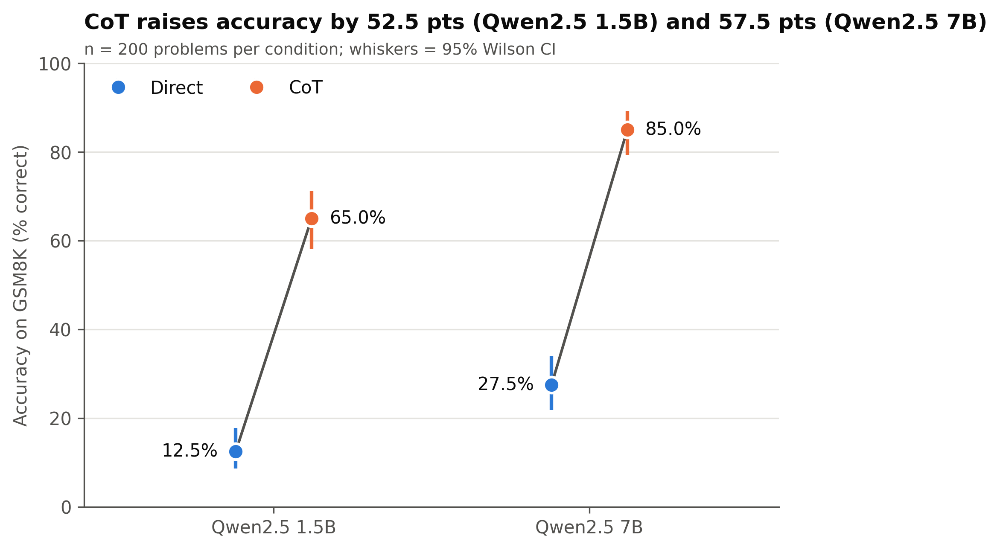
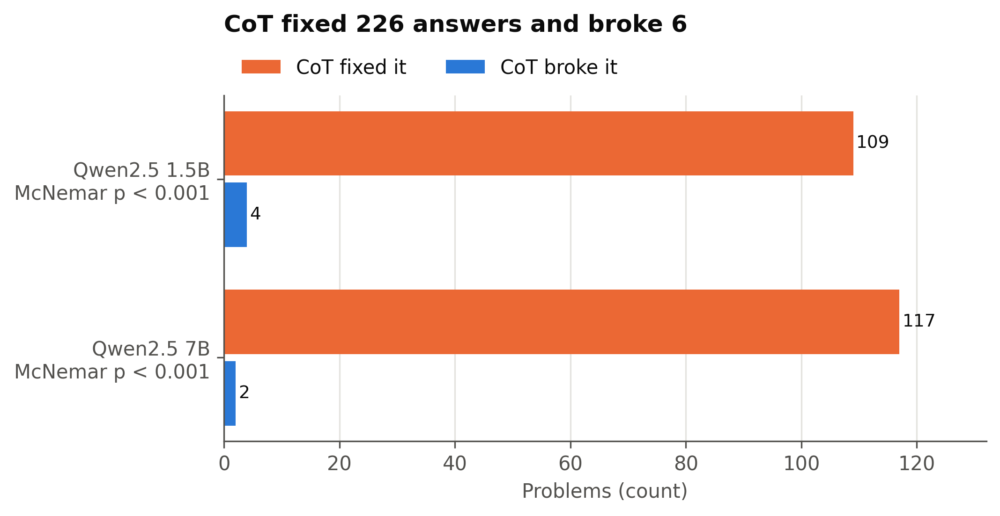
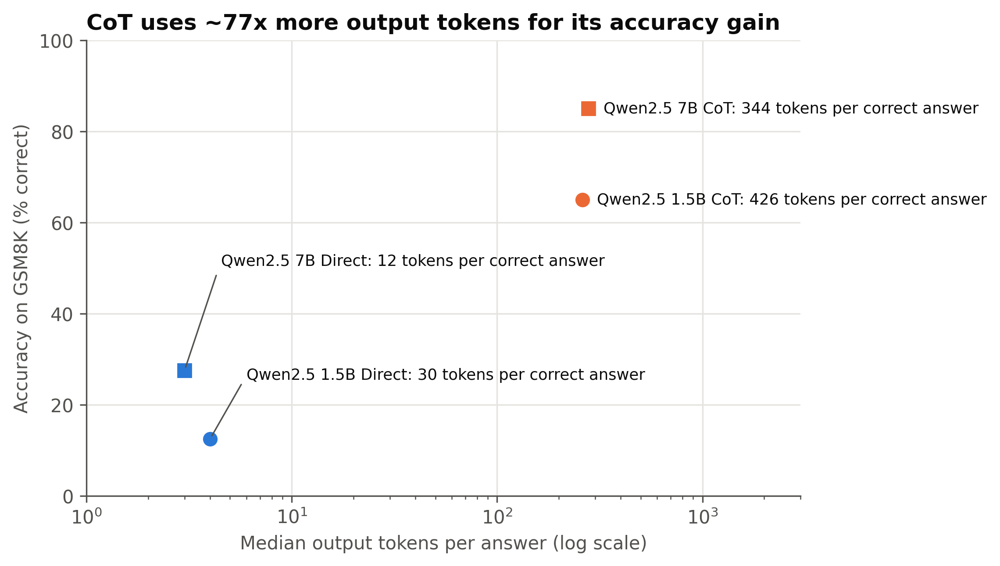

# Chain-of-Thought vs. Direct Prompting on GSM8K

**Does asking a small open-weight LLM to "think step by step" improve its accuracy on grade-school math word problems, and is the gain worth the extra tokens?**

AIPI 510 Module Project 2 (Duke) · John Fillingim

## Headline result

On 200 GSM8K test problems, chain-of-thought (CoT) prompting raised accuracy:
- from **12.5% to 65.0%** for Qwen2.5 1.5B
- from **27.5% to 85.0%** for Qwen2.5 7B

Both gains are significant (exact McNemar p < 10⁻²⁶). CoT fixed 226 answers and broke 6.

**Is it worth the tokens?** CoT used about **70–90× more output tokens** per problem. Per *correct* answer it cost **14–28× more**: 344 vs. 12 tokens for 7B, 426 vs. 30 for 1.5B. That is still only a few hundred tokens per correct answer, and it buys 3–5× higher accuracy. **The 1.5B model with CoT (65%) beat the 7B model answering directly (27.5%).** Whether the gain is the same size for both models is inconclusive: the H2 interaction was not significant.



## Design

| | |
|---|---|
| **Design** | 2 × 2 within-subjects: prompt style (Direct, CoT) × model size (small, large). Every problem runs under all four conditions. |
| **Models** | `qwen2.5:1.5b` and `qwen2.5:7b` (Q4_K_M), served locally with [Ollama](https://ollama.com). Digests are pinned in `config.yaml`. |
| **Data** | 200 problems from the GSM8K test split (`openai/gsm8k`, `main`), sampled with seed 510. A disjoint 30-problem pilot froze the prompts and the answer extractor. |
| **Prompts** | **Direct:** respond with only the final number. **CoT:** think step by step, then give the final number after `####`. Both use the same system message. Full text is in [`config.yaml`](config.yaml). |
| **Controls** | Temperature 0, seed 510, 512-token cap, `num_ctx` 4096. Within each model, problem × prompt order is shuffled. |
| **Outcome** | Correct if the extracted number equals the gold answer. Extraction: the number after `####`, otherwise the last number. Unparseable responses count as incorrect. |
| **Sample size** | Connor (1987) McNemar power analysis: n = 188 for p10 = .15, p01 = .05, α = .025, power = .80. The pilot's discordance implied n ≤ 13. |

All hypotheses and tests were preregistered in [`PREREGISTRATION.md`](PREREGISTRATION.md) before the main data collection.

## Results

| Model | Prompt | Accuracy (95% CI) | Median output tokens | Tokens per correct answer (95% CI) |
|---|---|---|---|---|
| Qwen2.5 1.5B | Direct | 12.5% (8.6–17.8) | 4 | 30 (22–47) |
| Qwen2.5 1.5B | CoT | 65.0% (58.2–71.3) | 260.5 | 426 (377–486) |
| Qwen2.5 7B | Direct | 27.5% (21.8–34.1) | 3 | 12 (10–16) |
| Qwen2.5 7B | CoT | 85.0% (79.4–89.3) | 279.5 | 344 (316–376) |

Accuracy CIs are Wilson intervals. Cost CIs come from a problem-level bootstrap (10,000 resamples).

**H1: CoT changes accuracy (per model, exact McNemar, α = 0.025). Supported for both models.**

| Model | CoT − Direct (Newcombe 95% CI) | CoT fixed / broke | Discordant OR (95% CI) | p |
|---|---|---|---|---|
| Qwen2.5 1.5B | +52.5 pts (44.5 to 59.4) | 109 / 4 | 27.3 (10.3–101.8) | 1.3 × 10⁻²⁷ |
| Qwen2.5 7B | +57.5 pts (49.7 to 63.9) | 117 / 2 | 58.5 (15.8–488.7) | 2.1 × 10⁻³² |

- **Omnibus:** Cochran's Q = 285.1 (df = 3), p = 1.7 × 10⁻⁶¹. All six Holm-corrected pairwise McNemar tests are significant (p < 10⁻⁵). That includes **1.5B + CoT beating 7B + Direct**: 82 vs. 7 discordant problems.
- **H2: prompt × model interaction. Not supported.**
  - Conditional logit LRT: χ²(1) = 1.82, p = 0.18.
  - Interaction OR = 2.09 (95% CI 0.70–6.25), estimated from the 162 problems whose outcomes vary across cells.
  - GEE robustness check: OR = 1.15 (0.65–2.03), p = 0.63.
  - On the accuracy scale, the gains are similar: +52.5 vs. +57.5 points.
- **H3: CoT produces more output tokens. Supported.**
  - Median paired increase: 257 tokens (1.5B) and 276.5 tokens (7B).
  - Hodges–Lehmann estimates: 267 (95% CI 253–281) and 283.5 (271.5–296.5).
  - Wilcoxon p < 10⁻³³ for both.
  - Rank-biserial r = 1.0: CoT was longer on every problem.
- **Robustness:**
  - There were 0 parse failures, so H1 excluding them is identical.
  - Bootstrap 95% CIs for the accuracy difference agree with the Newcombe intervals: +45.0 to +60.0 (1.5B) and +50.5 to +64.5 (7B).
  - Truncated responses: 4 (1.5B CoT) and 5 (7B CoT) hit the 512-token cap.

| | |
|---|---|
|  |  |

**Exploratory (not preregistered as a test): CoT gain by the number of steps in the reference solution.**
- Direct accuracy collapses as problems get longer. For 7B it falls from 54% on 2-step problems to 8% on problems with 5+ steps.
- CoT holds up much better (96% → 70% for 7B).
- The CoT gain stays large, about 40–65 points, at every difficulty level, with no clear trend.

See `figures/fig4_exploratory_gain_by_steps.png` and `results/exploratory_cot_gain_by_steps.csv`.

## Limitations

- **Models.** Both models come from one family (Qwen2.5) and are 4-bit quantized and run locally. The results may not carry over to other families or to full-precision models.
- **Direct prompt.** It forbids any working, which is a strict baseline. A "brief reasoning" prompt would likely fall in between.
- **Decoding.** One greedy sample per problem (temperature 0). We did not measure sampling variability or self-consistency.
- **Token cap.** The 512-token cap truncated 9 of 400 CoT responses. These are scored as incorrect, which slightly understates CoT accuracy.
- **H2 power.** The study was powered for H1, not for the interaction. The interaction CI (OR 0.70–6.25) is wide, so a moderate difference between models can't be ruled out.
- **Extraction.** The answer extractor is rule-based. Every incorrect pilot answer was checked by hand, but the main run was not exhaustively audited.

## Reproduce

Requirements: Windows with PowerShell, Python 3.10, and [Ollama](https://ollama.com) running locally.

```powershell
git clone https://github.com/john-fillingim/cot-vs-direct-prompting.git
cd cot-vs-direct-prompting
python -m venv .venv
.venv\Scripts\Activate.ps1
pip install -r requirements.txt
ollama pull qwen2.5:1.5b
ollama pull qwen2.5:7b

.\run_all.ps1 -Pilot   # optional: 30-problem pilot (~30 min)
.\run_all.ps1          # full pipeline (~4 h on a 4 GB GPU; resumable)
```

Or run each step:

```powershell
python -m src.sample_problems    # -> data/raw/problems.csv
python -m src.run_experiment     # -> data/raw/responses.jsonl (resumable)
python -m src.clean              # -> data/clean/results.csv
python -m src.analyze            # -> results/*.csv, results/*.json
python -m src.figures            # -> figures/*.png
```

The raw responses are committed, so you can rerun every analysis and figure without a GPU: run the last three commands only. `make all` does the same where `make` is available. Run the tests with `pytest` and lint with `ruff check .`.

> Note: Ollama must report the same model digests as `config.yaml`. If a model tag has been updated since, the runner will refuse to start.

## Repository layout

```
config.yaml              all settings: models + digests, seeds, sample sizes, prompts, paths
PREREGISTRATION.md       hypotheses and analysis plan (committed before data collection)
src/sample_problems.py   seeded GSM8K sample (main + disjoint pilot)
src/run_experiment.py    resumable Ollama runner, one JSON line per response
src/clean.py             answer extraction and scoring
src/power_analysis.py    Connor (1987) McNemar sample size
src/analyze.py           paired tests, conditional logit, bootstrap
src/figures.py           report figures (300 dpi)
tests/                   pytest unit tests (CI runs ruff + pytest on every PR)
data/raw/                raw problems and model responses (never edited)
data/clean/              scored results
results/                 analysis tables
figures/                 PNG figures
```
